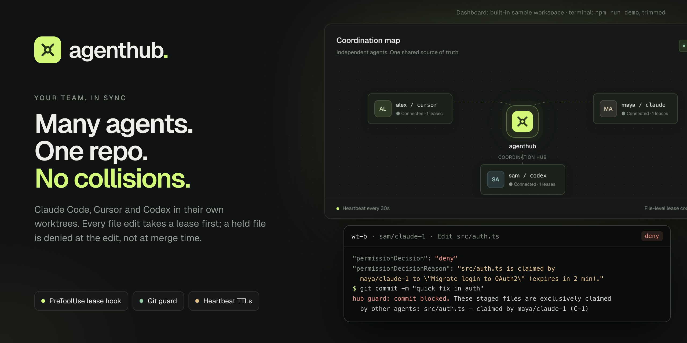
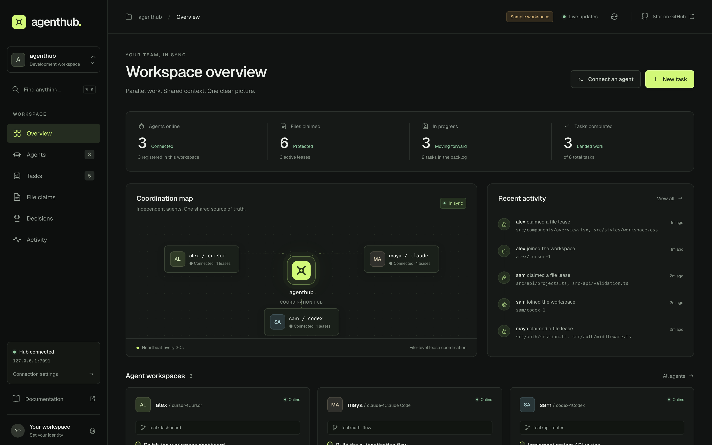
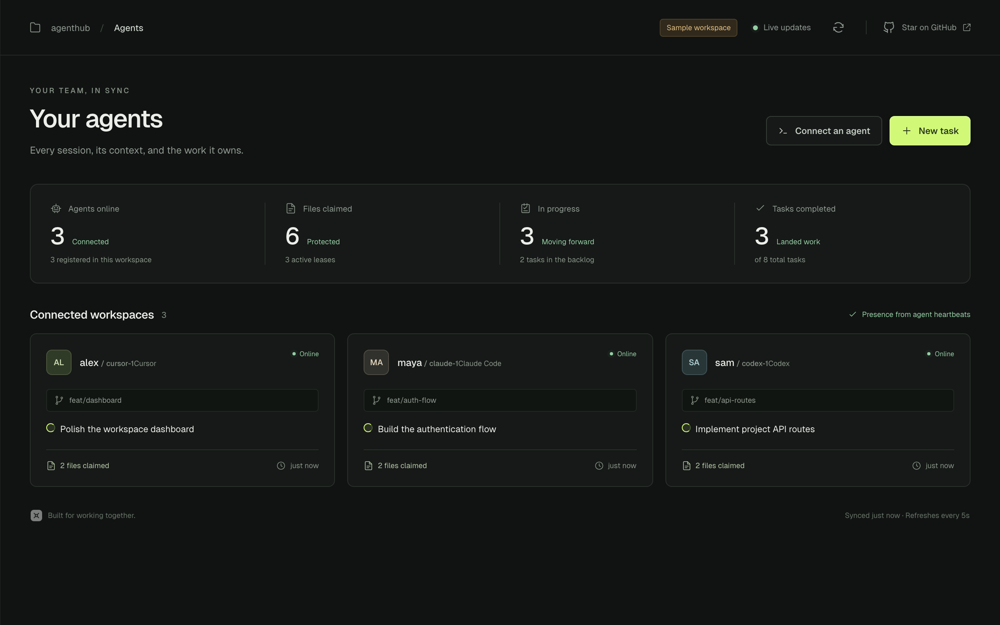
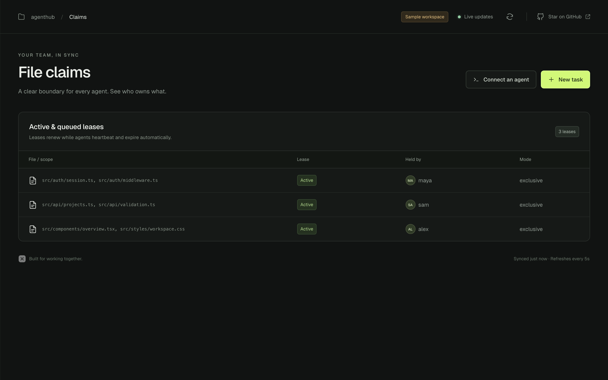
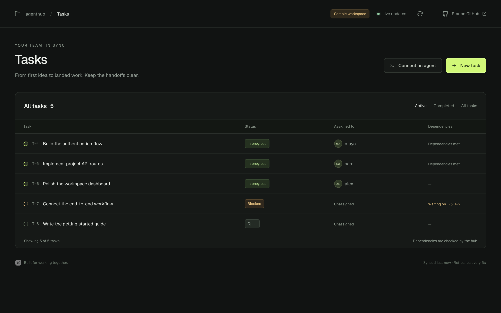
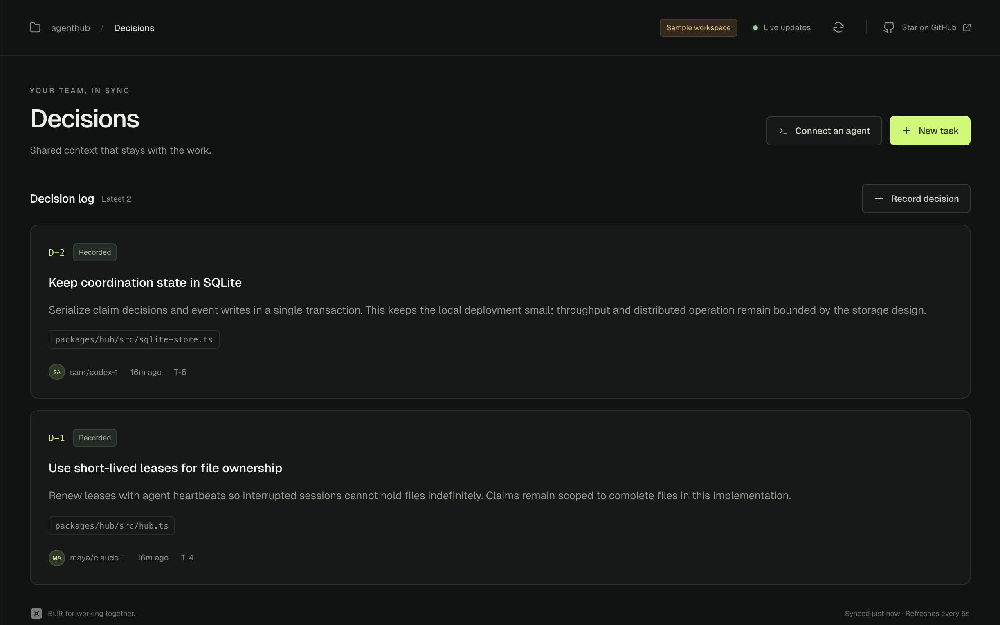
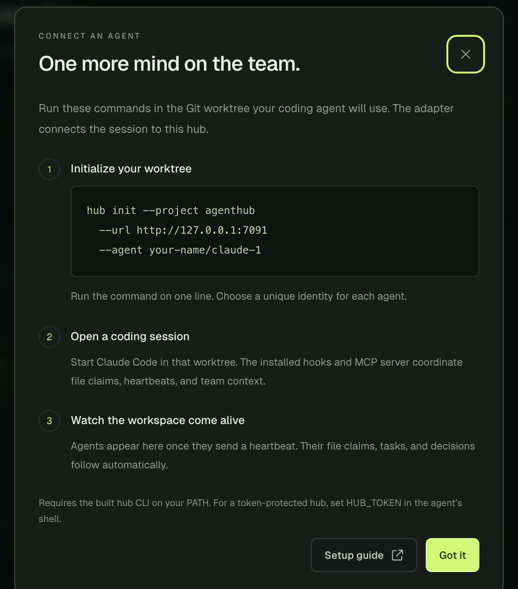
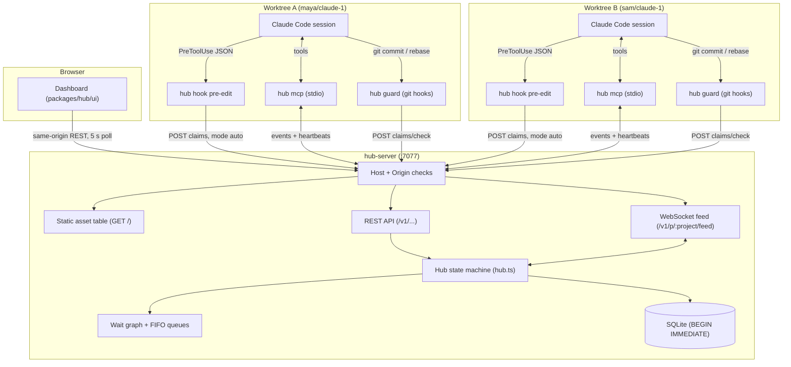

<div align="center">

# agenthub

**Real-time coordination hub and lease-enforcement adapter for teams running concurrent AI coding agents on one Git repository.**

[Quickstart](#quickstart) · [Dashboard](#built-in-dashboard) · [Architecture](#architecture) · [Engineering Deep Dives](#engineering-deep-dives) · [Demo Walkthrough](#demo-two-agents-in-two-worktrees) · [Limits](#phase-1-limits-and-roadmap)

<br/>

[](LICENSE)
[](package.json)
[](#verification-and-testing)
[](#architecture)
[](#built-in-dashboard)

<br/>



</div>

---

## What It Does

When several people run AI coding agents (Claude Code, Cursor, Codex) against one repository, parallel edits collide: two agents rewrite the same file, and the conflict surfaces only at merge time.

`agenthub` moves that conflict to the moment of the edit:
- Each human/agent pair works in its own Git worktree.
- A coordination hub tracks presence, tasks, an append-only decision log, and **file leases**.
- Claims are **enforced inside the tool edit path**: a Claude Code `PreToolUse` hook requests a lease before every `Edit`, `Write`, `MultiEdit`, or `NotebookEdit`, and denies the edit if another agent holds the file.
- Tools that run without hooks are caught by a **Git guard** that checks staged files on commit, rebase, revert, cherry-pick, and merge.
- Every claim is a **heartbeat-backed lease** with a TTL, so a crashed session or abandoned worktree releases its files automatically.
- `hub-server` serves a **built-in web dashboard** showing agents, leases, tasks, decisions, and activity for every project on the hub.

```text
packages/hub                  @agenthub/hub      Hub server: SQLite + HTTP + WebSocket + dashboard (bin: hub-server)
packages/adapter              @agenthub/adapter  Agent side: Claude Code hooks, MCP server, git guard (bin: hub)
scripts/demo.sh                                  Scripted two-agent, two-worktree walkthrough
scripts/dashboard-demo.mjs                       Disposable in-memory hub with a sample workspace for the dashboard
```

---

## Core Capabilities

| Edit-Path Lease Enforcement | Git Hook Guards |
| :--- | :--- |
| **`PreToolUse` interception**<br/>Claude Code edits are checked before they touch disk. If another agent holds the file, the edit is denied with the holder, their stated intent, and the lease expiry. | **Commit, rebase and merge protection**<br/>`hub init` installs `pre-commit`, `prepare-commit-msg`, `pre-merge-commit`, and `pre-applypatch` guards, and chains existing hooks (husky, custom scripts) instead of replacing them. |

| Deadlock-Refusing Claim Queues | Shared Team State |
| :--- | :--- |
| **FIFO wait queues with cycle detection**<br/>Queued claims are promoted in order when holders release or expire. A queue request that would close a wait cycle is refused with 409 `deadlock`, naming the cycle. | **Tasks, decisions, digest**<br/>Task dependencies (`T-n`), an append-only decision log (`D-n`), and a team digest injected into each agent session at `SessionStart`. |

| MCP Tool Surface | Loopback-First Network Security |
| :--- | :--- |
| **stdio MCP server**<br/>Exposes `claim`, `hub_wait`, `hub_post`, `inbox`, `decide`, `land` and more to the model, and keeps leases alive with WebSocket heartbeats. | **Host and Origin validation**<br/>Refuses foreign browser origins and DNS-rebound host names, and wraps all peer-written text as untrusted data before it reaches a model. |

---

## Built-in Dashboard

`hub-server` serves a dashboard at its root URL. It is five static files in [`packages/hub/ui/`](packages/hub/ui/): HTML, CSS, one ES module, an SVG favicon, and a self-hosted Geist font. There is no framework, build step, or CDN. It reads the same REST API the agents use.

<p align="center">
  
</p>

| Agents | File claims |
| :---: | :---: |
|  |  |
| Presence from heartbeats: client, branch, current task, claimed files, last seen. | Active and queued leases with the files, holder, and mode (`exclusive` / `shared`). |

| Tasks | Decisions |
| :---: | :---: |
|  |  |
| Status, owner, and dependency state. `T-7` shows as blocked on `T-5, T-6` because the hub says so. | Append-only `D-n` entries with rationale, files, author, and the linked task. |

<sub>Captured at 1440×900 @2x from `npm run demo:dashboard`. The data is a seeded sample, created through the real `Hub` API in an in-memory database.</sub>

**What it does**
- **Reads** `GET /v1/projects`, `/v1/p/:project/status`, and cursor-paged `/v1/p/:project/events`. It refreshes every 5 s while the tab is visible, plus on focus and when the network comes back. If the database epoch changes (a recreated database), it drops its cached events.
- **Writes** go through the same validation as the CLI: *New task* (with an optional dependency) and *Record decision*, under a `human/agent` identity you set.
- **Connect an agent** shows the exact `hub init --project … --url … --agent …` command for the hub you are viewing.
- **Navigation**: ⌘K search across agents, tasks, claims, and decisions, plus a switcher for every project on the hub.
- **Credentials**: a bearer token entered in *Connection settings* stays in page memory and clears on reload. Only the identity is kept, in `sessionStorage`.

### Try it

```bash
npm install
npm run demo:dashboard
# → AgentHub sample workspace: http://127.0.0.1:7077/?project=agenthub&sample=1
```

This starts a hub on an in-memory SQLite database seeded with 3 agents, 8 tasks, 3 leases, and 2 decisions. Nothing is written to disk, and Ctrl+C discards it. Set `HUB_PORT` to use another port.

To view a real hub, start it with `npm run dashboard` (which builds and runs `hub-server` with `./hub.db`) and open `http://127.0.0.1:7077/`. Pass server flags after `--`, for example `npm run dashboard -- --token "$HUB_TOKEN"`.

<p align="center">
  
</p>

---

## Architecture

`agenthub` pairs an agent-side adapter CLI with a hub process that keeps all state in SQLite and serves it over HTTP and WebSocket.



### End-to-End Execution Flow

1. **Pre-edit interception**: When Claude Code invokes `Edit` on a file (e.g. `src/auth.ts`), the `PreToolUse` hook runs `hub hook pre-edit`.
2. **Path and identity resolution**: The adapter resolves the worktree root and agent identity from the *target file's* path, not Claude's working directory, so an edit aimed at another worktree is checked under that worktree's configuration.
3. **Serialized lease evaluation**: The hook sends `POST /claims` with mode `auto`. The hub decides inside a SQLite `BEGIN IMMEDIATE` transaction, checking for an exclusive holder or an earlier queued waiter on that path.
4. **Grant or deny**:
   - **Grant**: The lease is recorded with its TTL and the hook exits 0, so the edit proceeds.
   - **Deny**: The hook returns `permissionDecision: "deny"` naming the holder, their intent, and the time to expiry. Claude Code cancels the edit and tells the model why.
5. **Heartbeats and landing**: The long-running `hub mcp` process heartbeats over the WebSocket feed (default every 30 s) to keep leases alive. `hub land` marks the task done, releases its claims, and reports which tasks it unblocked. The dashboard picks up the change on its next poll.

---

## Engineering Deep Dives

### 1. One Serialized Write Path with Cycle-Refusing Queues

- **Problem**: Many agents claim and queue files at once. Without one ordering, two agents can both be granted the same file, or A can wait on B while B waits on A.
- **Approach**: Every claim decision in [`hub.ts`](packages/hub/src/hub.ts) runs inside a SQLite `BEGIN IMMEDIATE` transaction in [`sqlite-store.ts`](packages/hub/src/sqlite-store.ts). Before a `queue: true` request joins a queue, the hub checks the project's wait graph. The graph is cached per project and reused while few events have landed since it was built (rebuilt past 100). A request that would close a cycle is refused with 409 `deadlock`, naming the cycle.
- **Why**: A single write lock gives one ordering for grants and their events with no consensus protocol, and several `hub-server` processes can share one database file. The test suite races six OS processes on one file and asserts exactly one grant.
- **Tradeoff**: All claim writes go through SQLite's single writer lock. That is ample for a team, but it is not a distributed store, and this repository includes no throughput benchmark.

### 2. Resolving Identity from the Target Path, Not the Caller

- **Problem**: An agent in `worktree-a` can be told to edit `../worktree-b/src/index.ts`. A hook that trusts `process.cwd()` applies the wrong identity, or none.
- **Approach**: [`hooks.ts`](packages/adapter/src/hooks.ts) and [`checkout.ts`](packages/adapter/src/checkout.ts) resolve the target's real path, find the enclosing worktree, and load *that* worktree's `.hub.json` identity and `agenthub.json` project. Paths are compared in Unicode NFC, so macOS-decomposed and Linux-composed names match.
- **Why**: Otherwise an agent working from an unmanaged scratch directory could edit managed files without a lease check.
- **Tradeoff**: Each hook call does an extra filesystem walk to find the worktree root before the HTTP request.

### 3. Git Guards That Chain Existing Hooks

- **Problem**: A naive installer overwrites the team's existing hooks (husky, lefthook, custom scripts). Plain `pre-commit` also misses rebase, revert, cherry-pick, and merge commits.
- **Approach**: [`init.ts`](packages/adapter/src/init.ts) and [`guard.ts`](packages/adapter/src/guard.ts) install the guard in four hooks. An existing shell hook is kept as `<name>.pre-agenthub` and runs after the guard passes. Symlinked and non-shell hooks move to `.git/agenthub-kept/` at the same directory depth.
- **Why**: Teams will not adopt a coordination tool that breaks their lint and test hooks.
- **Tradeoff**: Every guarded Git operation starts a Node process and makes a round trip to the hub. Commit latency has not been measured here, and `HUB_GUARD=off` exists as an emergency bypass.

### 4. A Browser UI on a Hub That Refuses Browsers

- **Problem**: The hub refuses any request carrying a foreign `Origin` and validates `Host` on loopback, so web pages cannot reach a local hub through the developer's browser or DNS rebinding. A dashboard needs browser access anyway.
- **Approach**: [`server.ts`](packages/hub/src/server.ts) serves the UI itself, from an explicit five-entry asset table, so no URL maps to a filesystem path. Every asset response carries a strict CSP (`default-src 'self'`, `frame-ancestors 'none'`), `nosniff`, and `no-referrer`. A request whose `Origin` equals `http://<Host>` is accepted only when that Host can't be rebound: an IP address, a localhost name, or a name given with `--allow-host`. A page on a rebound name is refused on every bind address. The static shell is public, but `/v1/projects` and every project route still require the bearer token.
- **Why**: Same-origin serving needs no CORS allowlist, no second server, and no new dependency. A token kept in page memory never reaches `localStorage` or a URL.
- **Tradeoff**: The dashboard polls every 5 s instead of using the WebSocket feed, so updates can lag by up to one interval. The same-origin rule only matches `http://`, so behind a TLS-terminating proxy the public origin must be added with `--allow-origin`.

---

## How It Works

### Claims as Heartbeat-Backed Leases
- **Scope**: Repo-relative POSIX paths (`src/auth.ts`) compared in Unicode NFC. Invalid paths (bidi overrides, `..` traversal, null bytes) are rejected with 400 `invalid_path`.
- **Modes**:
  - `exclusive`: Conflicts with every other claim. Used for active edits.
  - `shared`: Coexists with other shared holders. Used for append-only files (e.g. `CHANGELOG.md`).
  - `auto`: Used by edit hooks. Takes `exclusive` if the file is free and `shared` if only shared holders exist. Denies if there is an exclusive holder or an earlier queued waiter.
- **Lifecycle**: Default lease 2 minutes (`--lease-ttl-ms`), default heartbeat 30 seconds (`--heartbeat-ms`). A sweeper runs every second to expire leases whose heartbeats stopped and promote the next waiter.

### Untrusted Agent Data Boundary
- Inter-agent messages, claim intents, and task titles are treated as untrusted text.
- Message bodies are wrapped in `<untrusted from="agent_id">…</untrusted>`, with any embedded closing tags defused.
- Displayed text is stripped of ANSI escapes, Unicode bidi controls, and invisible format characters. The dashboard HTML-escapes every value it renders.
- Session reminders tell the model that text inside untrusted tags is teammate information, never instructions to run tools.

---

## Demo: Two Agents in Two Worktrees

The repository includes a scripted end-to-end walkthrough ([`scripts/demo.sh`](scripts/demo.sh)). The manual equivalent:

```bash
# Terminal 0: start the coordination hub
hub-server --db ./demo-hub.db              # http://127.0.0.1:7077 (dashboard at /)

# Terminal 1: sample repo and two worktrees
mkdir -p /tmp/agenthub-demo && cd /tmp/agenthub-demo
git init -b main sample && cd sample
mkdir src
printf 'export function login(user: string) {\n  return `session-${user}`;\n}\n' > src/auth.ts
git add -A && git commit -m "initial"

hub init --project demo
git add agenthub.json .claude .mcp.json && git commit -m "agenthub setup"

git worktree add ../wt-a -b agent-a
git worktree add ../wt-b -b agent-b
(cd ../wt-a && hub init --agent maya/claude-1)
(cd ../wt-b && hub init --agent sam/claude-1)

cd ../wt-a
hub task add "Migrate login to OAuth2"
hub task add "Rate-limit login attempts" --dep T-1
```

### Scripted Output (`npm run demo`)

```text
== 4. maya/claude-1 edits src/auth.ts: the PreToolUse hook claims it
$ <Edit payload for .../wt-a/src/auth.ts> | hub hook pre-edit
(no output: edit allowed)
$ hub decide "login() returns {token, expiresAt}" --file src/auth.ts
recorded D-1 · maya/claude-1 · just now: "login() returns {token, expiresAt}" [src/auth.ts]
$ hub post sam/claude-1 "Moving login to OAuth2; please stay off src/auth.ts until T-1 lands"
sent #1 to sam/claude-1

== 5. sam/claude-1 starts session: receives SessionStart team digest
Active claims by others (1):
- C-1 src/auth.ts — maya/claude-1 (exclusive, task T-1): "Migrate login to OAuth2" · lease 2 min

== 6. sam/claude-1 attempts to edit src/auth.ts: denied by hook
{
  "hookSpecificOutput": {
    "hookEventName": "PreToolUse",
    "permissionDecision": "deny",
    "permissionDecisionReason": "src/auth.ts is claimed by maya/claude-1 to \"Migrate login to OAuth2\" (expires in 2 min)."
  }
}

== 7. sam/claude-1 edits a free file: allowed
(no output: edit allowed)

== 8. Un-hooked tool attempts to git commit src/auth.ts: blocked by git guard
hub guard: commit blocked. These staged files are exclusively claimed by other agents:
  src/auth.ts — claimed by maya/claude-1 (C-1) to "Migrate login to OAuth2" (expires in 2 min)

== 9. maya/claude-1 commits and lands T-1: claims released, T-2 unblocked
$ hub land --task T-1
recorded L-1 for T-1 (done); released C-1
unblocked: T-2

== 10. sam/claude-1 retries edit on src/auth.ts: allowed now
(no output: edit allowed)
```

---

## MCP Tool Surface

The adapter exposes these Model Context Protocol tools over stdio:

| Tool | Parameters | Description |
|---|---|---|
| `hub_status` | *(none)* | Presence, active and queued claims, open tasks, unread count, recent decisions, and the latest event sequence number. |
| `task_list` | *(none)* | All project tasks with dependency status and owners. |
| `task_take` | `task_id` | Assigns an open task to the caller. Refused with 409 `task_blocked` while dependencies are open. |
| `task_create`| `title`, `description`, `deps` | Creates a task with optional prerequisites. |
| `claim` | `files`, `intent`, `mode`, `queue` | Acquires a file lease (`exclusive`, `shared`, `auto`). Refused with 409 if queueing would form a cycle. |
| `release` | `claim_id`, `files`, `task_id`, `all` | Releases held or queued leases. |
| `hub_wait` | `files`, `timeout_ms` | Waits until contended files are free or a queued claim is granted. |
| `hub_post` | `recipient`, `body` | Sends a direct or channel message to peer agents. |
| `inbox` | `peek` | Reads unread messages, wrapped in `<untrusted>` with sender attribution. |
| `decide` | `summary`, `rationale`, `files` | Appends a decision to the log. |
| `land` | `task_id` | Marks the task done, releases its claims, and reports newly unblocked tasks. |

---

## Technology Stack

| Layer | Technology |
| :--- | :--- |
| **Runtime** | Node.js 22.12+, TypeScript, ESM, two-package workspace |
| **Agent integration** | Claude Code hooks (`PreToolUse`, `PostToolUse`, `SessionStart`, `Stop`, `SubagentStop`, `UserPromptSubmit`, `SessionEnd`), `@modelcontextprotocol/sdk`, `zod` |
| **Git guard** | POSIX shell wrappers for `pre-commit`, `prepare-commit-msg`, `pre-merge-commit`, `pre-applypatch` |
| **Hub server** | Node `http` router, `ws` WebSocket feed with JSON frames |
| **Storage** | SQLite via `better-sqlite3` (`BEGIN IMMEDIATE` transactions) |
| **Dashboard** | Plain HTML/CSS and one ES module, no build step. Self-hosted Geist font ([SIL OFL 1.1](packages/hub/ui/FONT-LICENSE.txt)) |
| **Tests** | Vitest, with real Git repositories and spawned `hub-server` processes as fixtures |

---

## Quickstart

### Prerequisites
- Node.js 22.12 or higher
- Git 2.30+

### Install, Build, Test

```bash
git clone https://github.com/aiden-guan/agenthub.git
cd agenthub
npm install
npm test                                   # builds both packages, then runs Vitest

# Put the hub and hub-server binaries on your PATH
export PATH="$PWD/node_modules/.bin:$PATH"
```

### Run It

```bash
npm run demo:dashboard   # sample workspace in the dashboard, nothing written to disk
npm run demo             # scripted two-agent, two-worktree walkthrough
npm run dashboard        # a real hub-server on :7077 with ./hub.db; open http://127.0.0.1:7077/
```

### Connect an Agent

In the Git worktree an agent will use:

```bash
hub init --project my-project --url http://127.0.0.1:7077 --agent your-name/claude-1
```

Then start Claude Code in that worktree. The installed hooks and MCP server handle claims, heartbeats, and the team digest.

### Configuration

The adapter reads `<worktree>/.hub.json`, then `~/.config/agenthub/config.json`. Environment variables override both. See [`.env.example`](.env.example).

| Variable | Used by | Purpose |
| :--- | :--- | :--- |
| `HUB_URL` | adapter | Hub address (default `http://127.0.0.1:7077`) |
| `HUB_AGENT` | adapter | Identity override for this shell (`human/agent`) |
| `HUB_TOKEN` | both | Shared bearer token (`hub-server --token`) |
| `HUB_FAIL_CLOSED` | adapter | `1` denies edits and commits while the hub is unreachable (default: allow, with a warning) |
| `HUB_GUARD` | adapter | `off` bypasses the Git guard in an emergency |
| `HUB_PORT`, `HUB_HOST`, `HUB_DB` | hub-server | Listen port, bind address, database path |

`hub-server` binds to `127.0.0.1` by default. When binding to another address, set `--token` and name the host clients use with `--allow-host`.

---

## Repository Structure

```text
agenthub/
├── assets/readme/               # README hero and dashboard captures
├── packages/
│   ├── hub/                     # @agenthub/hub — coordination server
│   │   ├── src/
│   │   │   ├── cli.ts           # hub-server flags, env parsing, startup checks
│   │   │   ├── hub.ts           # Claim state machine, queues, wait-graph cycle detection
│   │   │   ├── protocol.ts      # Request/response and event types shared with the adapter
│   │   │   ├── server.ts        # HTTP routes, Host/Origin checks, WebSocket feed, dashboard assets
│   │   │   ├── sqlite-store.ts  # better-sqlite3 store (BEGIN IMMEDIATE)
│   │   │   └── store.ts         # Store interface
│   │   ├── ui/                  # Built-in dashboard: index.html, dashboard.js, dashboard.css, font
│   │   └── test/                # Hub logic, HTTP/WebSocket, multi-process race and dashboard tests
│   └── adapter/                 # @agenthub/adapter — agent-side CLI (bin: hub)
│       ├── src/
│       │   ├── cli.ts           # hub CLI entrypoint
│       │   ├── client.ts        # HTTP client and error mapping
│       │   ├── feed.ts          # WebSocket client with reconnect and event replay
│       │   ├── guard.ts         # Git hook guard
│       │   ├── hooks.ts         # PreToolUse, PostToolUse, SessionStart, settle handlers
│       │   ├── init.ts          # hub init: hooks, MCP config, git guards
│       │   └── mcp.ts           # stdio MCP server
│       └── test/                # Hook, guard (real Git repos), feed and MCP tests
├── scripts/
│   ├── demo.sh                  # Scripted two-agent walkthrough
│   └── dashboard-demo.mjs       # In-memory sample hub for the dashboard
├── REVIEW.md                    # Phase 1 review findings and their fix status
├── CHANGELOG.md
├── .env.example
└── package.json                 # Workspace scripts
```

---

## Verification and Testing

```bash
npm test             # build + full Vitest suite (both packages)
npm run test:watch   # watch mode
npm run typecheck    # tsc --noEmit for both packages
```

### Verified Scenarios
- **Claim races**: 30 concurrent HTTP clients, and 6 separate OS processes on one SQLite file, each produce exactly one grant.
- **Lease expiry**: Leases expire after missed heartbeats, including on half-open sockets, and the next waiter is promoted.
- **Git guards**: Real repository fixtures confirm `git commit`, `rebase`, `revert`, and `cherry-pick` are blocked on files claimed by others.
- **Dashboard**: The static shell is public with CSP and `nosniff`. Project data stays behind the token. The dashboard's own origin is accepted, while foreign origins, rebound hosts, and path traversal (`/dashboard.js/../server.ts`) are refused.

---

## Phase 1 Limits and Roadmap

- **Self-asserted identity**: Agents identify themselves with `x-hub-agent`. A shared bearer token (`--token`) is supported. Per-user auth (SSO / GitHub App) is planned for a later phase.
- **File-level granularity**: Leases cover whole files. Symbol-level claims (via Tree-sitter) are planned for Phase 3.
- **Landing**: `hub land` marks tasks done and releases leases. Merging still uses plain Git. An automated merge queue is planned for Phase 2.
- **Unconfirmed claims**: A claim taken for an edit the user then rejects is released at the next turn boundary (`hub hook settle`).
- **Dashboard**: It polls every 5 s rather than streaming. It can create tasks and record decisions but cannot take, release, or land work, which stays with agents through the CLI and MCP tools.
- **No published packages, hosted instance, or CI** yet. Everything above runs from a local clone.

---

## License

This project is licensed under the [MIT License](LICENSE). The bundled Geist font is under the [SIL Open Font License 1.1](packages/hub/ui/FONT-LICENSE.txt).
